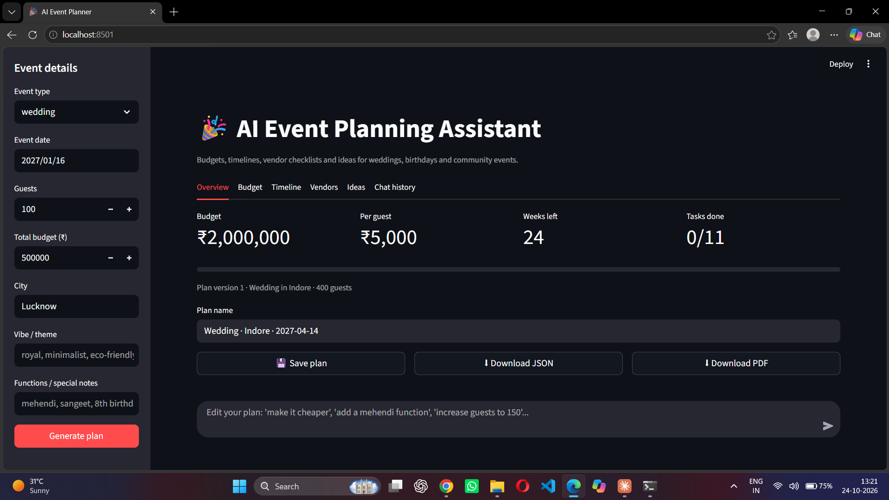
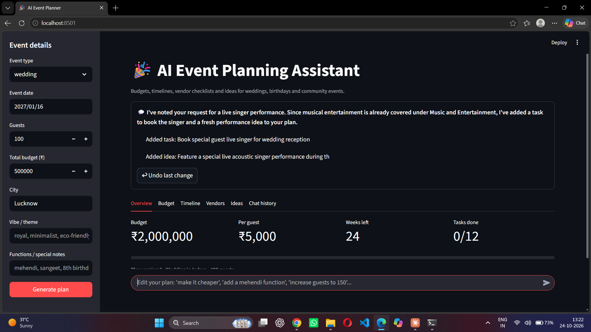

# 🎉 AI Event Planning Assistant

A GenAI-powered planner for **weddings, birthdays and community events**. Enter the basics
(date, guests, budget, city, vibe) and get a full plan: budget split, dated timeline,
vendor checklist and personalised ideas. Then refine it by chatting:
*"make it cheaper"*, *"add a mehendi function"*, *"increase guests to 150"*.

## The problem

Planning an event means juggling budgets, deadlines and vendors in notes, spreadsheets and
WhatsApp threads. First-time planners rarely know what to book when, or how much each
category should cost. This tool gives them a realistic starting plan in seconds.

## Features

- **Budget** with a per-category share and rupee amount, always summing exactly to the total
- **Timeline** with real calendar dates, worked backwards from the event date
- **Vendor checklist** with questions to ask and cost ranges that fit the budget
- **Ideas** matched to the theme, city, guest count and budget
- **Chat refinement**: edit the plan in plain language, see exactly what changed, and undo
- **Save / load plans** (SQLite) and **export** to PDF or JSON
- **Warnings** for unrealistic plans (very high category share, tight cost per guest, short timeline)

## How it works

```
Streamlit UI  ->  Orchestrator  ->  LLM call 1: budget (percentages only)
                       |             Python: budget math (exact rupees)
                       |             LLM call 2: timeline + vendors + ideas (sees the budget)
                       |             Python: dates, validation, fallbacks
                       v
                 Plan (Pydantic)  ->  SQLite  ->  PDF / JSON
```

Design decisions:

1. **The LLM suggests, Python computes.** LLMs are unreliable at arithmetic and dates, so the
   model returns percentages and "weeks before"; code produces rupee amounts (forced to sum
   exactly to the budget) and calendar dates.
2. **Schema-validated JSON.** Every AI answer is parsed into a Pydantic model. On failure it
   retries once with the error fed back, then falls back to a built-in template, so the app
   never shows a stack trace.
3. **Chat edits are patches.** The model proposes a structured change; code validates it
   (budget changes outside 0.3x-3x are rejected, contingency can't be deleted) and applies it
   to a copy of the plan, with an undo stack.
4. **Sections agree with each other.** The details call sees the finished budget, so vendor
   price ranges and ideas fit the budget lines.
5. **Quota-aware.** Two LLM calls per plan, no retry on daily-quota errors, and a model
   fallback chain (`GEMINI_MODELS`) because free-tier quota is counted per model.

## Tech stack

Python · Streamlit · Google Gemini API (`google-genai`) · Pydantic · SQLite · ReportLab · pytest

## Setup

```bash
git clone <your-repo-url>
cd event-planner-ai
python -m venv venv
venv\Scripts\activate          # Windows   (Mac/Linux: source venv/bin/activate)
pip install -r requirements.txt
```

1. Get a free API key at <https://aistudio.google.com/apikey>.
2. Copy `.env.example` to `.env` and paste your key:
   ```
   GEMINI_API_KEY=your_key_here
   GEMINI_MODELS=gemini-3.8-flash,gemini-3.6-flash,gemini-3.5-flash-lite
   ```
3. Run:
   ```bash
   streamlit run app.py
   ```

Run the tests (no API key or internet needed, the AI is faked):

```bash
python -m pytest -q
```

## Project structure

```
app.py                  Streamlit UI
core/                   Pydantic models, config
llm/                    Gemini adapter with model fallback chain
prompts/                One prompt file per task
services/               planner (orchestrator), budget_calc, timeline_dates,
                        validators, refiner (chat -> patch)
storage/db.py           SQLite save/load
export/pdf.py           PDF export
data/templates/         Fallback templates per event type
tests/                  Unit tests
```

## Accessibility

- Text and button colours meet WCAG AA contrast (4.5:1 or better): body text 13.3:1, secondary text 5.4:1,
  placeholders 4.9:1, white text on primary buttons 4.8:1 or better. Ratios were calculated, not guessed.
- Visible keyboard focus outline on every control, and all controls are at least 44 px tall.
- Semantic headings (one `h1`, `h2` sections, `h3` cards); decorative emoji are hidden from screen readers.
- Respects the "reduce motion" setting.
- The budget chart has a text alternative (the table plus a caption).
- Not yet tested with a screen reader.

## Limitations (honest notes)

- Vendor cost ranges are **AI estimates, not quotes**. The tool suggests categories and
  questions, never invented business names.
- The chat can occasionally add something already covered. It shows every change and has Undo.
- Free-tier Gemini has daily request limits; when they run out the app uses templates and
  says why.
- PDF export uses built-in fonts, so non-Latin text (e.g. Hindi) appears as `?` in the PDF.

## Screenshots



